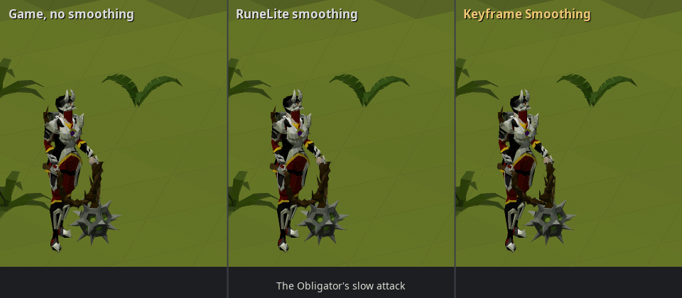
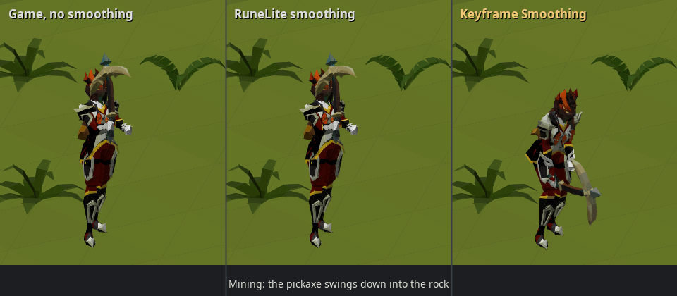
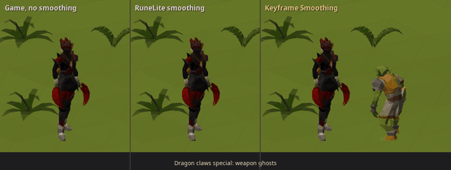

# Keyframe Smoothing

Smooth animations that keep their keyframes. Plain smoothing blends each part of a model from one keyframe to the next on its own, so arms and weapons can spin the long way round, swings lose their arc at every keyframe and hits lose their impact.

With Keyframe Smoothing, every attack, special and other action becomes one fluid motion through all of its keyframes. Each arm, leg and weapon turns along a curve and keeps its shape, every keyframe pose is shown exactly, and hits arrive at full speed. The plugin works each animation out from the game's own data the moment it starts, on your character's model as the game builds it (the first time too: a special attack is smooth the first time you use it), so new weapons and monsters work without updates. Animated objects (the Great Olm's head and hands) get plain smoothing. Where its curve would look worse than plain smoothing, it uses plain smoothing.

What it does differently:

- **Turns go the short way.** Between two keyframes, plain smoothing can spin an arm or a weapon all the way round. Keyframe Smoothing turns it the short way, as the keyframes mean it.
- **One curve through every keyframe.** Plain smoothing blends from keyframe to keyframe with a corner at each. Keyframe Smoothing follows one curve through all of them, so a swing keeps its arc.
- **Blows land with force.** Plain smoothing spreads a blow evenly over its keyframes. Keyframe Smoothing exaggerates it the way an animator would: the weapon winds up further than its keyframes in one flowing motion, turns straight round, strikes faster and faster, and carries on past the hit before it springs back. It still lands on time, and nothing swings through the floor. The same goes for skills that swing a tool, such as mining, chopping, harpoons and smithing: a wind-up, then a fast blow that lands on its keyframe and sound. Prefer the keyframes as they are? Turn off **Exaggerated blows**: blows then follow their keyframes exactly, only faster towards the hit.

## Blows that land

The exaggeration shows most on long blows. Two more of the longest in the game, each at full speed and then slowed down:

## Skilling

Tools get the same treatment: mining, chopping, harpoons and smithing swing with a wind-up and a fast blow that lands on its keyframe.

## Weapon ghosts

On top of the smoothing, a fading trail of your weapon, in the weapon's own colours, on the blows of an attack (not the wind-up or the way back). Whether an animation is an attack comes from its definition in the game, so the trail shows from your first attack on, and never when you block or eat.

Skilling (mining, woodcutting, harpoon fishing, smithing, building) leaves no trail by default; the **Skilling** toggle below puts the same trail on the strike of your tool (the hit part only, not the wind-up or the wait), also when it is in your inventory and the animation puts it in your hand. It needs Smoothing > Skilling on, and follows Weapon ghosts off and Special attacks only.

Keyframes and ghosts need the GPU plugin or another GPU renderer. Without one, animations are smoothed plainly.

## Settings

- **Smoothing**: on or off for your character, other players, NPCs, and objects and effects; off shows an animation keyframe to keyframe, as the game without smoothing. **Exaggerated blows** (on by default): attacks and skilling swings wind up further than their keyframes and carry on past the hit; off, blows follow their keyframes exactly, only faster towards the hit. **Hits on the hitsplat** (on by default): your own attacks land when their hitsplat and its sound come (melee: a game tick after the attack starts), shown faster up to the hit and slower after it; learnt from your first hits with each attack. **Skilling** (on by default): skilling swings strike as attacks do; off, they go as the game times them. **Hit on the chop sound** (off by default): chopping in the Gauntlet, your axe hits the tree each time you hear a chop; needs Skilling on.
- **Weapon ghosts**: on or off, on your special attacks only, and per combat style: melee, ranged, magic (a spell cast onto a monster or player, or autocast), and **Skilling** (off by default): the strike of a skilling tool.
- **Exceptions**: weapons (your attacks with them), NPCs and animated objects that get the opposite of the settings, by name (`Dragon claws, Abyssal *`): a **Smoothing** list and a **Ghosts** list (weapons). With smoothing on for NPCs, a monster on the Smoothing list is shown keyframe to keyframe; with it off, that monster alone is smoothed. Each list has a shift-right-click menu entry, off by default, that puts a monster, an object or a weapon in your inventory, bank or equipment on the list or takes it off: Smooth / Don't smooth, Ghosts / No ghosts.

You don't need RuneLite's Animation Smoothing turned on. If it is, both work together.
