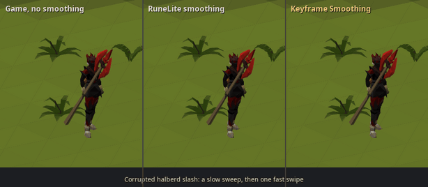
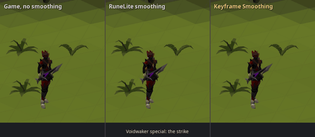

# Keyframe Smoothing

Turns every attack, special and other action into one fluid motion that keeps its keyframes.

Plain smoothing blends each keyframe into the next, which can spin arms and weapons the long way round and takes the force out of hits. This plugin follows one curve through all the keyframes. Attacks wind up further, strike faster and carry on past the hit, and still land on time.

Mining, chopping, harpooning and smithing get the same treatment.

Weapon ghosts leave a fading trail of your weapon on the blows of your attacks.

You can turn smoothing on or off for yourself, other players, NPCs and objects, and choose which attacks leave ghosts. Exaggerated blows can be turned off. Exceptions by name (`Dragon claws, Abyssal *`) get the opposite of your settings.

Keyframes and ghosts need the GPU plugin or another GPU renderer; without one, animations get plain smoothing. RuneLite's Animation Smoothing doesn't need to be on.
